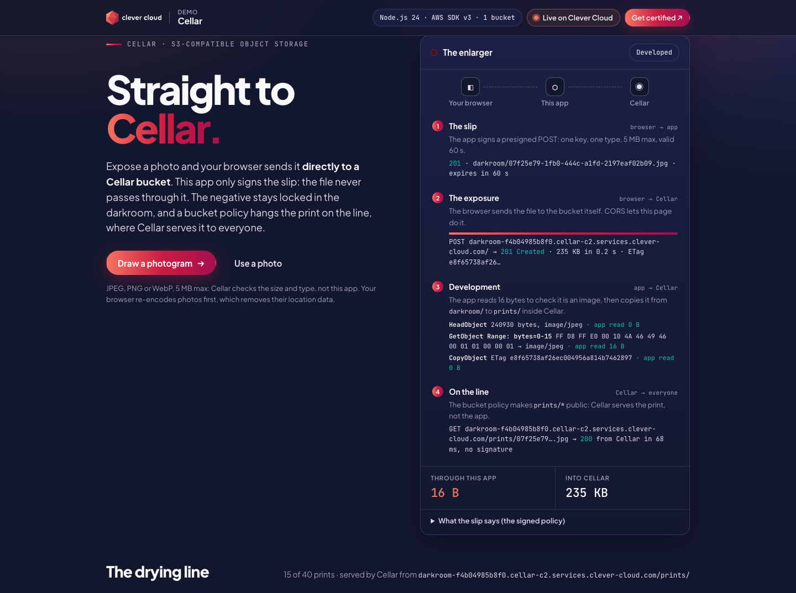
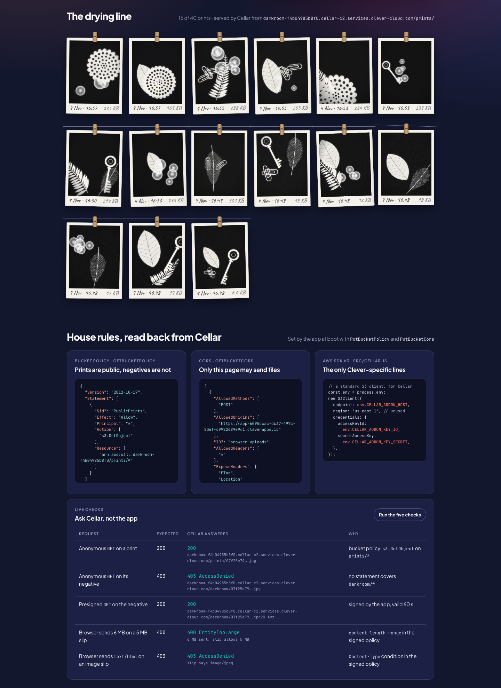
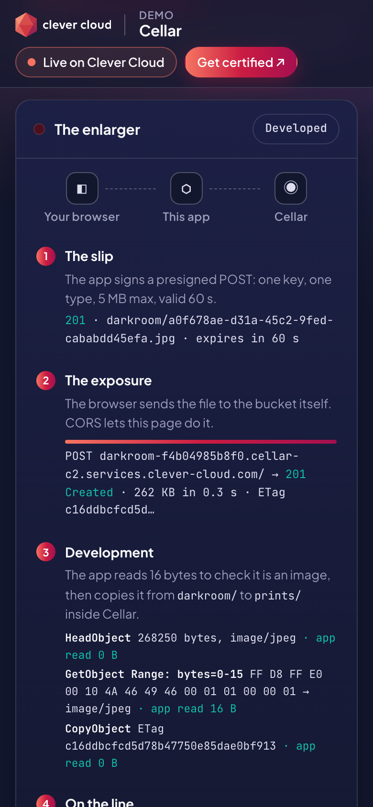
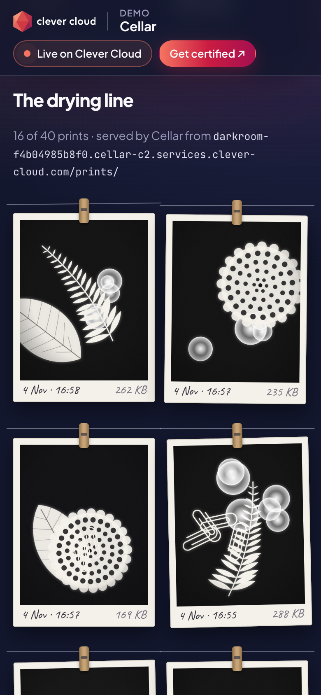
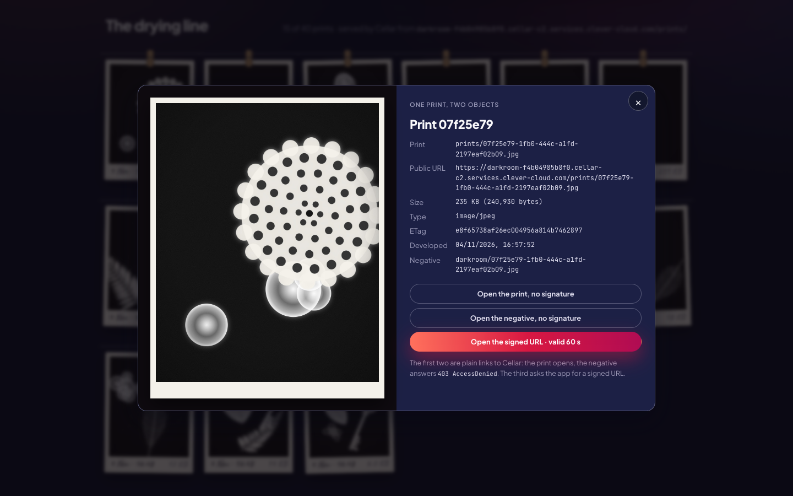

# The Darkroom — Cellar on Clever Cloud

> A darkroom where visitors expose photos and the app never touches them. The browser asks the app for a **presigned POST** (one key, one type, 5 MB max, valid 60 seconds), then sends the file **straight to a Cellar bucket**: the app reads 16 bytes of it, at most, to check that it is an image. The original, the *negative*, stays in a private `darkroom/` prefix. The app copies it inside Cellar to `prints/`, where a **bucket policy** lets anyone read it: the drying line loads every print from Cellar, not from the app. The app sets the bucket's **CORS** rules and policy itself at boot, reads them back from Cellar on the page, and five live checks ask Cellar to prove each rule: 200, 403, 200, 400, 403. Standard AWS SDK v3; only the endpoint and the variable names belong to Clever Cloud.





| Phone, the enlarger | Phone, the drying line |
|---|---|
|  |  |

**Run it yourself.** The hosted demo was taken down after the presales review (November 2026). The steps in [Deploy on Clever Cloud](#deploy-on-clever-cloud) recreate it from scratch in about 5 minutes. `npm run prove` then checks the whole chain from the outside.

**Get certified.** This demo runs on Clever Cloud. To deploy your own apps the same way, get certified at the [Clever Cloud Academy](https://academy.clever.cloud/).

## What Cellar does here



| Where | Cellar feature (S3 API) | What you see |
|---|---|---|
| Boot | `CreateBucket`, `PutBucketCors`, `PutBucketPolicy`, idempotent on every instance | *House rules*: the policy and the CORS rules, read back live with `GetBucketPolicy` and `GetBucketCors` |
| Step 1, `/api/slips` | Presigned POST (`createPresignedPost`): exact key, `eq $Content-Type`, `content-length-range 1 5242880`, expiry 60 s | *What the slip says*: the signed policy, decoded in the page. The secret key never leaves the server |
| Step 2, browser → bucket | Browser-based upload (POST Object, multipart) to `https://<bucket>.cellar-c2.services.clever-cloud.com/`, allowed by the CORS rule | A progress bar, then `201 Created` and the ETag. The ledger: **16 B** through the app, the whole file into Cellar |
| Step 3, `/api/develop` | `HeadObject`, ranged `GetObject` (`bytes=0-15`), then `CopyObject` `darkroom/` → `prints/` inside Cellar | The trace of the three calls and the bytes the app read for each: 0, 16, 0 |
| The drying line | Bucket policy: anonymous `s3:GetObject` on `prints/*` only | Every `` points to Cellar. The page's CSP allows exactly one other origin, the bucket |
| The print viewer | Presigned GET on `darkroom/<id>` (60 s) | Open the negative without a signature: Cellar's own `403 AccessDenied`. With the signed link: 200, and a countdown to expiry |
| *Live checks* | Five requests, three from the app as an anonymous stranger, two from the browser straight to Cellar | 200 on a print, 403 on its negative, 200 presigned, **400 `EntityTooLarge`** for 6 MB on a 5 MB slip, **403** for `text/html` on an image slip |

Why upload this way: the file goes from the browser to Cellar in one hop. The app instance (a `nano`) carries no upload bandwidth, holds no file in memory and needs no body-size limit of its own; Cellar enforces the size and the type from the signed policy, even for a client that lies about them. The CORS rule only accepts the app's origin (`https://app-<id>.cleverapps.io`, derived from `APP_ID`, plus `CORS_ORIGINS`): a page on another site cannot send files with these slips.

The visitor's photo is re-encoded by the browser before it leaves (canvas → JPEG, 2000 px max), which drops EXIF metadata such as the GPS position. The *Draw a photogram* button draws a cameraless photograph in the browser instead, so the demo needs no photo of anyone.

## Deploy on Clever Cloud

You need [clever-tools](https://www.clever.cloud/developers/doc/cli/) (`clever login` done) and the ID of the organisation that will own the resources (`orga_…`, shown in the Console). Run the commands from the repo root: `clever create` links the folder to the new app.

```bash
# 1. The app and its size
clever create --type node demo-cellar-darkroom --org <org_id> --region par
clever scale --min-flavor nano --max-flavor XS --min-instances 1 --max-instances 2

# 2. Cellar (plan S, the only one; the provider offers no encryption option), linked to the app
clever addon create cellar-addon demo-cellar-darkroom-cellar --plan S --region par --org <org_id>
clever service link-addon demo-cellar-darkroom-cellar

# 3. Health check
clever env set CC_HEALTH_CHECK_PATH /health

# 4. Deploy
clever deploy
clever open
```

There is no secret to generate: the linked add-on injects `CELLAR_ADDON_HOST`, `CELLAR_ADDON_KEY_ID` and `CELLAR_ADDON_KEY_SECRET`, read as they are. Clever Cloud runs `npm install` at build and `npm start` at run, with Node.js 24 from `engines` in `package.json`; there is no build step and no setup script. At first start the app creates its bucket, sets CORS and the policy, and develops six seed photograms. Check `https://<your-app>.cleverapps.io/health/deep` returns 200, then prove the chain:

```bash
npm run prove -- https://<your-app>.cleverapps.io
```

It runs 15 checks from the outside, like a browser and like a stranger: CORS preflight from the app's origin (allowed) and from another one (refused), the upload straight to Cellar, the development, 200 on the print, 403 on the negative, 200 presigned, and Cellar refusing an oversized file and a wrong type. It hangs one photogram on the line.

On a custom domain, add its origin to `CORS_ORIGINS` (`https://photos.example.com`) and `clever restart`: the rule is rewritten at boot.

To take the demo down: Cellar only deletes an add-on whose buckets are empty, and only the app holds the keys. So the app empties its own bucket first:

```bash
clever env set CELLAR_TEARDOWN true && clever restart   # logs: "[cellar] Teardown: N objects deleted, bucket … deleted"
clever addon delete <addon_id>
clever delete
```

## Variables

| Variable | Set by | Role |
|---|---|---|
| `CELLAR_ADDON_HOST` | the Cellar add-on | S3 endpoint, `cellar-c2.services.clever-cloud.com` |
| `CELLAR_ADDON_KEY_ID` | the Cellar add-on | Access key id. It also names the bucket: `darkroom-` + a hash of it, unique per add-on (bucket names are global on Cellar) |
| `CELLAR_ADDON_KEY_SECRET` | the Cellar add-on | Secret key, used server-side to sign; never sent to the page |
| `CC_HEALTH_CHECK_PATH` | you | `/health` |
| `CORS_ORIGINS` | optional | Extra origins allowed to upload, comma-separated (custom domains) |
| `CELLAR_BUCKET` | optional | Forces the bucket name |
| `CELLAR_TEARDOWN` | optional, at the end | `true`: at boot, empty the bucket and delete it instead of serving the darkroom |

The "Running on Clever Cloud" panel shows `CC_APP_NAME`, `APP_ID`, `INSTANCE_NUMBER`, `INSTANCE_TYPE`, `CC_PRETTY_INSTANCE_NAME`, `CC_COMMIT_ID` and `CC_DEPLOYMENT_ID`, and nothing else. `APP_ID` also gives the app's default domain, the origin of the CORS rule.

## Routes

`/` the darkroom · `POST /api/slips` (`{"type","size"}` → presigned POST, 12 per visitor per 10 min) · `POST /api/develop` (`{"key"}` → check and copy) · `/api/prints` · `/api/negatives/{id}` (presigned GET, 60 s) · `/api/rules` (policy and CORS read back from Cellar) · `/api/probes` (the three anonymous checks) · `/health` (no add-on) · `/health/deep` (`HeadBucket`). `POST` routes refuse another site's `Origin`.

The line holds 40 prints; the oldest come down with their negatives. A negative nobody developed (a tab closed mid-upload) is swept after 10 minutes.

## Code tour

```
server.js            HTTP routes, CSP with the bucket's origin, rate limit, boot (bucket, CORS, policy, seed)
src/cellar.js        every Cellar call, AWS SDK v3: presigned POST and GET, develop, probes, sweep, teardown
src/rules.js         the rules as data: bucket name, CORS rule, bucket policy, keys, magic numbers
public/darkroom.js   the browser side: slip, multipart POST to Cellar with progress, develop, the line, the checks
public/photogram.js  cameraless photographs drawn as SVG, shared by the seed and the browser
public/              index.html, darkroom.css; cc-brand.css is the Clever Brand Kit
scripts/prove.mjs    15 checks against a running instance
test/                node --test: rules, routes, and the real S3 calls against a local S3
```

Plain Node.js 24, no framework. Dependencies: `@aws-sdk/client-s3`, `@aws-sdk/s3-presigned-post`, `@aws-sdk/s3-request-presigner`.

## Run locally

```bash
uvx --from "moto[server]" moto_server -p 9100 &        # a local S3 standing in for Cellar
npm install
node --env-file=.env.example server.js                 # http://localhost:8080
S3_TEST_ENDPOINT=http://localhost:9100 npm test
```

Moto does not enforce bucket policies: the 403 checks only prove themselves on Cellar.

MIT License.
